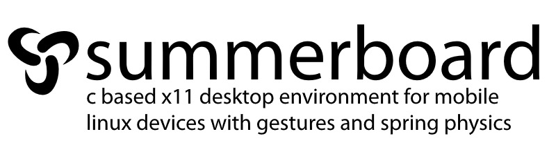

# Summerboard



Summerboard is an iOS-style tile springboard, gesture-based app launcher, and window manager for X11. Written in lightweight C, it targets tablets and convertibles (and SBCs) with spring physics, card multitasking, matchbox on-screen keyboard, and built-in system panels.

---

## Debian install (recommended)

Turn a **bare Debian server with no desktop environment** into a Summerboard tablet session (Xorg + Mesa glamor, no display manager).

**Requirements**

* Debian 12/13 (bookworm/trixie) on x86_64 or aarch64
* Working DRM/KMS GPU (`/dev/dri/card*`) — Intel/AMD/etc. via Mesa
* Network + `sudo` for the desktop user
* Roughly 200 MB free for packages and the WhiteSur icon theme

**One-liner**

```bash
git clone https://github.com/teutekeune/summerboard.git
cd summerboard && ./setup.sh && sudo reboot
```

`./setup.sh` will:

1. Install Xorg, Mesa, modesetting/glamor deps, libinput, matchbox-keyboard, fonts, and build tools  
2. Compile `summerboardv28_gl.c` against **Debian system Mesa**  
3. Probe GPU `BusID` + `/dev/dri` and write `/etc/X11/xorg.conf.d/` (modesetting + glamor + DRI3, touchscreen)  
4. Install `/usr/local/bin/summerboard`, `/usr/local/bin/rotate`, and assets under `~/summerboard`  
5. Set `SUMMERBOARD_PRESENT=egl`, wire getty **autologin** on tty1 → `startx` → `.xinitrc`  
6. Install matchbox-keyboard layouts **with a number row**

After reboot you should land on the Summerboard home screen. No GDM/lightdm/sddm is installed or required.

### Rebuild only

```bash
cc summerboardv28_gl.c -o summerboard \
  -I/usr/include/freetype2 \
  -lX11 -lXext -lXfixes -lEGL -lGL -lfreetype -lm
sudo install -m 755 summerboard /usr/local/bin/summerboard
sudo install -m 755 rotate /usr/local/bin/rotate
```

### Layout after setup

| Path | Role |
|------|------|
| `/usr/local/bin/summerboard` | Binary |
| `/usr/local/bin/rotate` | Autorotate / touch CTM helper |
| `~/summerboard/` | `SUMMERBOARD_DIR` (icons, wallpaper, font, `keyboard.xml`) |
| `~/.xinitrc` | Starts summerboard with `SUMMERBOARD_PRESENT=egl` |
| `/etc/X11/xorg.conf.d/20-modesetting.conf` | GPU |
| `/etc/X11/xorg.conf.d/40-libinput-touchscreen.conf` | Touch |

---

## Technical features


* **Tablet-first X11 shell** with spring physics, workspace paging, and card multitasking  
* **GPU path** via EGL/GL (set `SUMMERBOARD_PRESENT=egl`) on Mesa  
* **On-screen keyboard** via `matchbox-keyboard` (number row included in this tree)  
* **Autorotation** using IIO accelerometer + `rotate` (touch Coordinate Transformation Matrix)  
* **Built-in Wi-Fi / sound panels** (`iw`/`wpa_supplicant`, ALSA softvol boost)

---

## Hardware & cross-compilation (Alpine / ARM SBCs)

For older software-rasterizer builds (`summerboard.c`) on Alpine ARM, Docker + QEMU still works:

```bash
docker run --rm --privileged multiarch/qemu-user-static --reset -p yes
docker run -it --rm --platform linux/arm/v6 -v $(pwd):/work -w /work arm32v6/alpine:latest sh
apk add --no-cache build-base xorg-server-dev libx11-dev
gcc -O3 -fno-math-errno -o summerboard summerboard.c -lX11 -lXext -lm
```

Prefer the **Debian `setup.sh` + `summerboardv28_gl.c`** path above for convertibles and anything with a real GPU.

---

## Gestures

* **Open app** — tap icon  
* **App switcher** — drag up from the bottom edge  
* **Close app** — swipe up on a card in the switcher  
* **Keyboard** — tap the Keyboard icon (toggle; does not autostart)  
* **Pages** — drag left/right on the home grid  

---

## Optional runtime packages

* `matchbox-keyboard` — installed by `setup.sh`  
* `iw`, `wpa_supplicant`, `ip` — Wi-Fi panel  
* `xterm` — fallback terminal  
* `alsa-utils` — volume / boost in Settings  

---

## License

GPL-3.0. See `LICENSE`.
